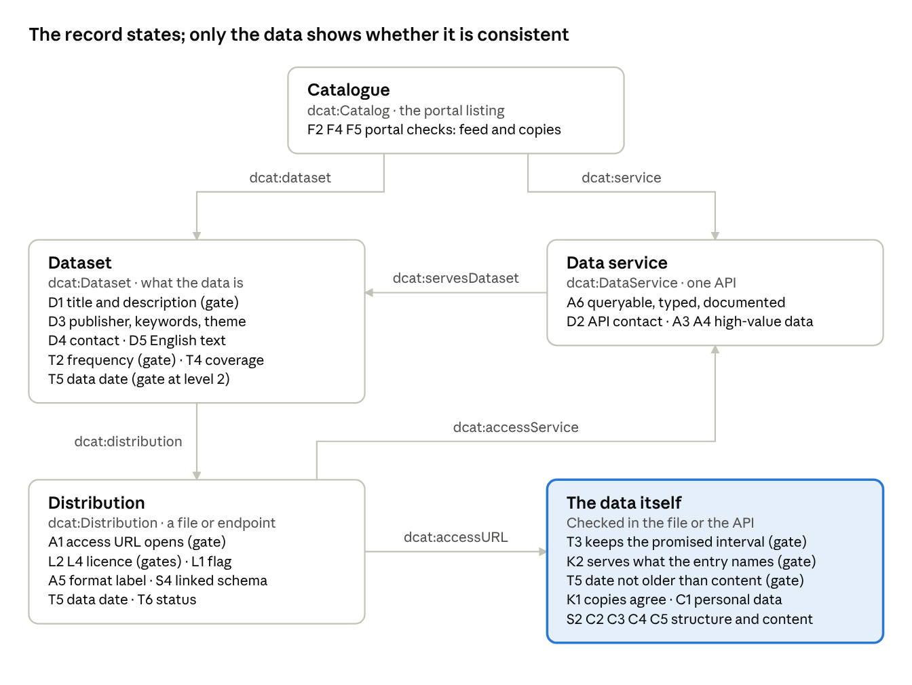

# Open data best practice DCAT-AP worked example for portals and AI use

Version 0.1, draft for comment · 12 November 2026 · Alex Gluhak

## About this document

A dataset description can conform to DCAT-AP with three mandatory properties, a title, a description and an access URL, and such a record still sits at "Not stated", below the first level of the best practice guidance. This document takes one description that conforms to DCAT-AP 3.0.1 and shows, property by property, which rules apply to it and what each check does.

It is the third in a set. The [guidance](guidance.md) explains the principles and the levels in plain words. The [rule reference](rule-reference.md) lists the 40 rules and the ten maintenance rules with their IDs, and this document uses those IDs. The example is invented and describes no real portal.

## DCAT-AP in brief

DCAT-AP is the European profile of the W3C DCAT vocabulary for describing datasets in a catalogue. It describes the metadata, never the data itself. It is an RDF vocabulary, so one record can be written as Turtle, JSON-LD or RDF/XML. [Version 3.0.1](https://semiceu.github.io/DCAT-AP/releases/3.0.1/) is a SEMIC Recommendation published on 27 October 2025.

Four classes carry most of a description:

| Class | What it describes | Mandatory properties |
| --- | --- | --- |
| Catalogue | The portal's listing | title, description, publisher |
| Dataset | What the data is, whatever form it takes | title, description |
| Distribution | One concrete way to get the data: a file or an endpoint | access URL |
| Data service | An API, described once for the datasets it serves | title, endpoint URL |

Every property is Mandatory, Recommended or Optional. To conform, a provider describes its catalogue, its datasets and their distributions with at least the mandatory properties, and takes values from the required controlled vocabularies, such as the EU frequency and file type lists. Recommended and optional properties may be left out. The annex for high-value datasets makes two more dataset properties mandatory: applicable legislation and HVD category.

DCAT-AP is an exchange profile. It fixes how a description is written so that one catalogue can pass it to another, and it does not set out to judge whether a description is complete or true. The levels in the guidance add that question; they are not a criticism of the profile.

## Where the rules attach



*Figure: DCAT-AP classes and the rules that read each.*

The four plain boxes are the record. The catalogue lists datasets and services, a dataset has distributions, and a distribution can point to the service behind it. The rules under each name are the ones that read that part of the record. The fifth box is the data the access URL leads to: three of the five gates for level 2, T3, T5 and K2, and every content rule can only be checked there.

## A compliant description, annotated

The record below describes one dataset with two distributions, a file and an API, and goes well beyond the minimum. Each line carries its DCAT-AP obligation (M mandatory, R recommended, O optional) and the rules that read it. It is written in Turtle; the same content can be sent as JSON-LD or RDF/XML.

```turtle
@base           <https://data.example.org/> .
@prefix dcat:   <http://www.w3.org/ns/dcat#> .
@prefix dct:    <http://purl.org/dc/terms/> .
@prefix foaf:   <http://xmlns.com/foaf/0.1/> .
@prefix vcard:  <http://www.w3.org/2006/vcard/ns#> .
@prefix adms:   <http://www.w3.org/ns/adms#> .
@prefix dcatap: <http://data.europa.eu/r5r/> .
@prefix xsd:    <http://www.w3.org/2001/XMLSchema#> .
@prefix freq:   <http://publications.europa.eu/resource/authority/frequency/> .
@prefix ftype:  <http://publications.europa.eu/resource/authority/file-type/> .
@prefix lic:    <http://publications.europa.eu/resource/authority/licence/> .
@prefix theme:  <http://publications.europa.eu/resource/authority/data-theme/> .
@prefix avail:  <http://publications.europa.eu/resource/authority/planned-availability/> .
@prefix dstat:  <http://publications.europa.eu/resource/authority/distribution-status/> .

# Catalogue: the portal's listing
<catalogue> a dcat:Catalog ;
  dct:title "Example city open data"@en ;                  # M
  dct:description "Open data published by the city."@en ;  # M
  dct:publisher <org/city> ;                               # M
  dcat:dataset <dataset/bike-counts> ;                     # R   F2 F4 F5
  dcat:service <service/api> ;                             # R
  dcat:record  <record/bike-counts> .                      # O

# Agent: the organisation that publishes
<org/city> a foaf:Agent ;
  foaf:name "Example city"@en .                            # M

# Catalogue record: the entry itself, not the data
<record/bike-counts> a dcat:CatalogRecord ;
  foaf:primaryTopic <dataset/bike-counts> ;                # M
  dct:modified "2026-11-03T09:12:00Z"^^xsd:dateTime .      # M   T5 (catalogue edit date)

# Dataset: what the data is
<dataset/bike-counts> a dcat:Dataset ;
  dct:title "Bicycle counts"@en , "Fietstellingen"@nl ;    # M   D1 (gate) D5
  dct:description
    "Hourly counts of passing bicycles at 12 counters, since 2019."@en ,
    "Uurtellingen van passerende fietsen op 12 telpunten, sinds 2019."@nl ;  # M   D1 (gate) D5
  dct:publisher <org/city> ;                               # R   D3
  dcat:keyword "cycling"@en , "traffic"@en ;               # R   D3
  dcat:theme theme:TRAN ;                                  # R   D3
  dcat:contactPoint [ a vcard:Kind ;
      vcard:hasEmail <mailto:opendata@example.org> ] ;     # R   D4
  dct:temporal [ a dct:PeriodOfTime ;
      dcat:startDate "2019-01-01"^^xsd:date ] ;            # R   T4
  dct:accrualPeriodicity freq:DAILY ;                      # O   T2 (gate) T3 (gate)
  dct:modified "2026-11-10T06:00:00Z"^^xsd:dateTime ;      # O   T5 (data date; gate at level 2)
  dcat:distribution <dataset/bike-counts/csv> ,
                    <dataset/bike-counts/api> .            # R

# Distribution 1: a file
<dataset/bike-counts/csv> a dcat:Distribution ;
  dcat:accessURL   <files/bike-counts.csv> ;               # M   A1 (gate)
  dcat:downloadURL <files/bike-counts.csv> ;               # O   A1 (gate)
  dct:format ftype:CSV ;                                   # R   A5
  dct:license lic:CC_BY_4_0 ;                              # R   L2 L4 (gates) L1
  dcatap:availability avail:STABLE ;                       # R
  dct:conformsTo <schemas/bike-counts.json> ;              # O   S4 S3
  dct:modified "2026-11-10T06:00:00Z"^^xsd:dateTime ;      # O   T5 (data date; gate at level 2)
  adms:status dstat:COMPLETED .                            # O   T6

<schemas/bike-counts.json> a dct:Standard .                # the schema the file follows

# Distribution 2: the same data through an API
<dataset/bike-counts/api> a dcat:Distribution ;
  dcat:accessURL <api/bike-counts> ;                       # M   A1 (gate)
  dct:format ftype:JSON ;                                  # R   A5
  dct:license lic:CC_BY_4_0 ;                              # R   L2 L4 (gates) L1
  dcat:accessService <service/api> .                       # O   A6

# Data service: the API, described once
<service/api> a dcat:DataService ;
  dct:title "Example city data API"@en ;                   # M
  dcat:endpointURL <api/> ;                                # M   A1 (gate)
  dcat:endpointDescription <api/openapi.json> ;            # R   A6
  dcat:servesDataset <dataset/bike-counts> ;               # R
  dcat:contactPoint [ a vcard:Kind ;
      vcard:hasEmail <mailto:opendata@example.org> ] .     # R   D2
```

Of the lines above, only eight are mandatory: three on the catalogue, the publisher's name, two on the dataset and one on each distribution. The catalogue record is optional, and the data service appears only because this portal describes its API; once described, each has two mandatory properties of its own.

The record was checked on 11 November 2026 against the validation shapes published with DCAT-AP 3.0.1. It parses as Turtle and passes the shapes for mandatory properties and for value types, with the EU vocabularies stood in for by type statements. The check for recommended properties lists 20 gaps, most of them on the catalogue, the catalogue record and the data service; on the dataset itself only geographical coverage is missing.

## Property by property

The table reads the record the way a check does. Most of the properties the rules depend on are Recommended or Optional in DCAT-AP, and two of the three gates for level 1 rest on them: the licence gate on a Recommended property and the frequency gate on an Optional one.

| Property | Sits on | DCAT-AP | Rules | Level | What the check does |
| --- | --- | --- | --- | --- | --- |
| title, description | Dataset | Mandatory | D1 | Stated (gate) | Both are present and not empty |
| language tags on title and description | Dataset | Part of the text values | D5 | Stated | An English text stands beside the local one |
| publisher, keyword, theme | Dataset | Recommended | D3 | Stated | All three are given |
| contact point | Dataset | Recommended | D4 | Stated | A contact email is given |
| frequency | Dataset | Optional | T2, T3 | Stated (gate), Consistent (gate) | T2: the value comes from the vocabulary that applies, here the EU Frequency list, and is not "unknown" or "other". T3: where an interval is promised, the newest record, a change to the file, or the stated data date shows that it is kept |
| temporal coverage | Dataset | Recommended | T4 | Stated, Consistent | A period is given; its start and end match the first and last dates in the data |
| modification date | Dataset, Distribution | Optional | T5 | Stated, Consistent (gate) | A data date exists, apart from the catalogue edit date, and the content is not newer than it |
| modification date | Catalogue record | Mandatory, where a record is given | T5 | Stated | This is the catalogue edit date; it must not stand in for the data date |
| status | Distribution | Optional | T6 | Stated | A status is given. DCAT-AP has no status for the dataset as a whole; an ended series shows it by changing its frequency to "never" or "not planned" |
| access URL, download URL | Distribution | Mandatory, Optional | A1 | Consistent (gate) | The link opens and returns the file or service it names, not an error or an empty file |
| format, media type | Distribution | Recommended, Optional | A5 | Stated, Consistent | The label comes from the EU File Type list; the file is what the label says |
| licence | Distribution | Recommended | L1, L2, L4 | Stated (gate), Consistent (gate) | L2: every distribution has one, given as a link to its text. L1: whether it allows commercial and non-commercial re-use; a licence that does not is a warning flag, not a failed gate. L4: the code, the title and the files name the same licence |
| linked schemas | Distribution | Optional | S4, S3 | Stated, machine-use marker | A schema or code list is linked; it gives every column a description, type and unit |
| access service, endpoint URL, endpoint description | Distribution, Data service | Optional, Mandatory, Recommended | A6 | Machine-use marker | A queryable API with typed fields and online documentation exists beside the bulk file |
| contact point | Data service | Recommended; Mandatory in the high-value annex | D2 | Stated | High-value APIs only: a point of contact for the API |
| HVD category, applicable legislation | Dataset | Mandatory in the high-value annex | F1, then A3, A4, L3, S1, T1 | Stated, Consistent | The dataset is marked as high-value; the rules for high-value data then apply. The annex also makes a contact point and documentation mandatory for the API |
| dataset, catalogue | Catalogue | Recommended, Optional | F2, F4, F5 | Portal checks | The feed carries every property the entry shows, and each harvesting catalogue keeps them |

One recommended property in the record, availability, has no rule: it says how long the publisher plans to keep a distribution online, and nothing in the guidance checks it.

## What the record cannot show

A record states things about the data; it cannot prove them. The rules below have no DCAT-AP property to read, or read one only to compare it with the data, so a perfect record says nothing about whether they are met.

| Rules | What they ask | Why the record cannot show it |
| --- | --- | --- |
| T3 (gate) | Where an interval is promised, the data keeps to it | The promise is in the record; whether it is kept shows only in the data or the file |
| K2 (gate) | The entry serves the dataset and period it names | Only opening the file or calling the API shows what is behind the link |
| T5 (gate) | The stated data date is not older than the content | The date is in the record; when the content last changed is only in the data or the file |
| K1 | Copies of the same data agree | No property says that two distributions hold the same content |
| S2, C2, C3, C4, C5 | Clean tables, typed values, one code for missing values, unique rows, locations in the right area | These are properties of the file's content |
| C1 | Free of personal data | The record can assert it; only the content can show it |
| C6, T7 | Stable columns and identifiers across a series; gaps documented | They compare one release with the next |
| S3 | Every column described, with type and unit | DCAT-AP links a schema and has no column-level properties of its own |
| T6, at dataset level | A status for the series as a whole | Status exists only on the distribution |
| F3 | Search finds the data, also in English | It is a behaviour of the portal, not a property |
| K3 and the supporting maintenance practices | Checks before release, yearly review, response time | Only the publisher can show them |

Three of the five gates for level 2 are in this table. That is why no level above Stated can be reached from the metadata alone.

## From conformant to Kept consistent

The smallest record that conforms to DCAT-AP and still points at the data has three mandatory properties:

```turtle
<dataset/bike-counts> a dcat:Dataset ;
  dct:title "Bicycle counts"@en ;
  dct:description "Hourly counts of passing bicycles at 12 counters."@en ;
  dcat:distribution [ a dcat:Distribution ;
      dcat:accessURL <files/bike-counts.csv> ] .
```

The table shows what each level adds to it.

| Step | What is added | Where |
| --- | --- | --- |
| Conformant, Not stated | Title, description and an access URL | The record, mandatory properties only |
| 1. Stated | A licence on every distribution, given as a link to its text, and an update frequency from the EU Frequency list, with a date for the data where it is "irregular" or "as needed" | The record: one Recommended and one Optional property |
| 2. Consistent | Nothing new in the record. Five checks pass: the links open and return what they name, the licence is the same throughout, the data keeps to the frequency, the stated data date is not older than the content, and the entry serves what it names | The data, compared with the record |
| 3. Kept consistent | Nothing new in the record. The same checks pass every time for three months, or for three update cycles, and the frequency is changed to "never" or "not planned" when a series ends | The data over time |

A catalogue can therefore be fully conformant and have every dataset at Not stated. The step to Stated is small, two properties, and both are already defined in the profile.

## A typical record, for contrast

Many records hold the same facts as free text. The one below describes the same dataset the way it often leaves a portal.

```turtle
<dataset/bike-counts> a dcat:Dataset ;
  dct:title "Bicycle counts"@en ;                          # D1 met
  dct:description "Bicycle counts."@en ;                   # D1 met in form; it repeats the title
  dct:modified "2026-11-03T09:12:00Z"^^xsd:dateTime ;      # T5 not met: this is the catalogue edit date
  dct:accrualPeriodicity "Frequent" ;                      # T2 not met: text, not a value from the EU list
  dcat:distribution [ a dcat:Distribution ;
      dcat:accessURL <files/bike-counts.csv> ;             # A1 can be checked
      dct:license "Creative Commons Attribution" ;         # L2 not met: a name, no link to the text
      dct:format "csv" ] .                                 # A5 not met: not from the EU list
```

The three records side by side:

|  | Annotated record | Typical record | Minimum record |
| --- | --- | --- | --- |
| Validates against the DCAT-AP 3.0.1 shapes | Yes | No: licence, format and frequency are text where the profile expects a link | Yes |
| Level it can reach | Stated, and Consistent once the checks on the data pass | Not stated: the frequency is text, and the licence has no link | Not stated: no licence, no frequency |
| What a reading system can use | Every property | Title, description and link; the text values cannot be matched to a list | Title, description and link |

The typical record holds more than the minimum one and fares worse: it fails validation on three of the four properties it adds. The information exists on the portal, and it is lost in the way it is written.

## The record on its way

Software does not read the portal page. It reads the portal's machine-readable feed, or a copy of the record in a national catalogue or on data.europa.eu, where one catalogue lists another. Three portal checks follow the record along that route.

| Check | What it asks of the record |
| --- | --- |
| F4, the feed | The feed carries every property the entry shows, in a form the next system accepts |
| F5, each hop | The national catalogue and data.europa.eu keep the licence, the frequency, the contact and the link to the data |
| F2, harvesting | Every dataset in the catalogue arrives at both |

The form matters as much as the presence. DCAT-AP expects the licence to be a licence document and the frequency to be a value from the EU list, so both are written as links, not as text:

```turtle
dct:license "Creative Commons Attribution 4.0" ;   # text: fails validation, may be dropped
dct:license lic:CC_BY_4_0 ;                        # link to the EU licence list: it survives

dct:accrualPeriodicity "every day" ;               # text: fails validation, not a list value
dct:accrualPeriodicity freq:DAILY ;                # EU code with a defined interval
```

A portal that holds a licence and a frequency for every dataset, and exports them as text or leaves them out of the feed, has every dataset at Not stated: the items the level 1 gates need must appear on the page and in the feed, and say the same in both.

## References

- [DCAT-AP 3.0.1](https://semiceu.github.io/DCAT-AP/releases/3.0.1/), DCAT Application Profile for data portals in Europe (SEMIC Recommendation, 27 October 2025): classes, properties, obligation levels and conformance, read on 11 November 2026
- [DCAT-AP for high-value datasets 3.0.0](https://semiceu.github.io/DCAT-AP/releases/3.0.0-hvd/), the annex to the profile for datasets under Commission Implementing Regulation (EU) 2023/138
- [DCAT-AP 3.0.1 validation shapes](https://github.com/SEMICeu/DCAT-AP/tree/master/releases/3.0.1/html/shacl), from the SEMICeu/DCAT-AP repository: the shapes for mandatory properties, value types and recommended properties used for the checks reported here
- EU authority tables: [frequency](http://publications.europa.eu/resource/authority/frequency) and [file type](http://publications.europa.eu/resource/authority/file-type)
- [Open data best practice guidance for portals and AI use](guidance.md): principles and levels
- [Open data best practice rule reference for portals and AI use](rule-reference.md): the rules behind the IDs used here
