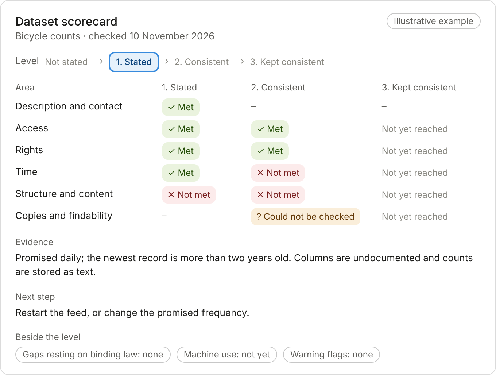
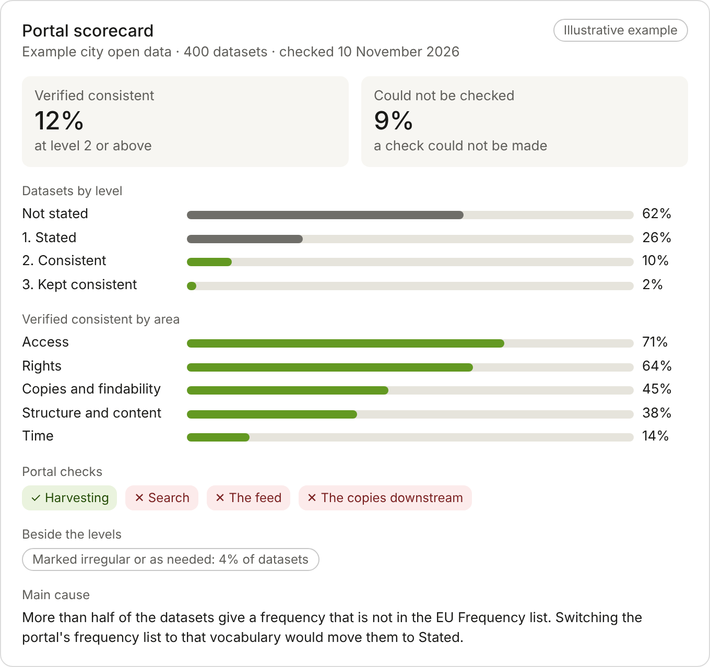

# Open data best practice guidance for portals and AI use

Version 0.1, draft for comment · 12 November 2026 · Alex Gluhak

## Why this guidance

A dataset on an open data portal is only useful if its data and its metadata are true, and true to each other. This guidance sets out what that means, in three levels that a dataset earns by evidence, with rules that can be checked from outside the portal.

Little here is new. Since the first public sector information directive (2003/98/EC), EU law has asked for re-usable public data, and since its 2013 amendment (2013/37/EU) for machine-readable formats with metadata, where possible; the Open Data Directive (EU) 2019/1024 adds open formats, APIs for dynamic data and high-value datasets, and the HVD Regulation (EU) 2023/138 makes licence, API, documentation and freshness binding for those datasets. DCAT-AP turns the metadata into a common European profile. Many of these rules are softened by "where possible", or are only Recommended or Optional in DCAT-AP. Outside the EU, national rules apply instead, in the United Kingdom for example the Re-use of Public Sector Information Regulations 2015 (SI 2015/1415); there, the rules below that rest on EU law read as good practice.

AI changes how much those softer rules matter. A person can read a description, guess a unit or notice that a file looks old; a software agent takes the metadata at its word. Newer law points the same way: the AI Act (EU) 2024/1689 Art. 10 asks providers of high-risk AI systems to use data that is relevant, representative and as free of errors and complete as possible, and to document data gaps; the Data Act (EU) 2023/2854 Art. 33(1)(a)–(b) asks data spaces to describe content, licences, collection method, quality, structures and code lists in machine-readable form. So several rules that are optional for a portal today are what an AI user needs.

The guidance adds checks of truth to checks of presence. The EU metadata quality assessment on data.europa.eu scores whether fields are filled in, not whether they match the data, and does not score update frequency; W3C's Data on the Web Best Practices and the FAIR principles describe good practice without levels or external checks. The Open Data Institute's Open Data Certificates do give levels, Bronze to Platinum, but mostly on the publisher's own answers to a questionnaire, and its framework for AI-ready data asks publishers to state an update schedule without checking that it is kept. ISO/IEC 25012 defines data quality characteristics such as consistency and currentness, and ISO/IEC 5259-2 applies them to data for analytics and machine learning; they say what to measure, not how to check a published entry from outside. ISO 8000-8 also asks that the scale against which quality is measured be stated, which is the idea behind holding a publisher to its own statement. This guidance keeps their aims, ties each rule to its legal or DCAT-AP basis, and checks the data against the metadata. At this stage it is best practice guidance, not a standard or a new norm, and the tables built on it are not a legal audit.

The five-star scheme for open data rates openness and format on the day of publication: an open licence, a machine-readable and open format, identifiers and links to other data. It does not ask whether the description is true, or still true a year later. The levels in this guidance continue where the stars stop: the stars say that data can be used, the levels say whether it can be trusted, and whether it still can.

The guidance comes from looking at portals from the outside, the way a user or an agent does. Two lessons stand out. Complete metadata is not the same as correct metadata: a portal can fill in nearly every field and still have many datasets well behind the update schedule they promise. And what a portal shows is not what reaches the systems that read it: the machine-readable feed often leaves out metadata the portal holds, and national and European copies can lose more on the way.

## Principles

Ten principles sit behind every rule. Most are already in law or DCAT-AP; the last column says why each one matters more when the user is software. Principles 1, 2 and 3 ask a publisher to keep to what it has itself stated; the others say what should be stated or provided in the first place.

| Principle | Where it comes from | Why it matters more for AI |
| --- | --- | --- |
| 1. Data and metadata agree | DCAT-AP 3.0.1 property definitions; Data Act Art. 33(1)(a) | An agent cannot see that a date, format or coverage contradicts the file; it trusts the metadata |
| 2. Promises are kept, or changed | Update frequency: DCAT-AP Optional; dynamic data: Open Data Directive Art. 5(5) | Stale data is used as if it were current |
| 3. Every copy says the same | DCAT-AP 3.0.1 (the catalogue record that harvesters read); national portals: Open Data Directive Art. 9(1), "where possible" | Agents, search engines and data spaces read the feed or a harvested copy, not the portal page; what is lost on the way is invisible to the publisher |
| 4. Data is machine-readable and typed | Open Data Directive Art. 5(1) and 2(13); HVD Regulation Art. 3(1) | Numbers stored as text, stand-in values and print layouts break sums, filters and joins |
| 5. Structure and meaning are documented | HVD Regulation Annex (most categories); Data Act Art. 33(1)(b); DCAT-AP Optional | Without units and definitions, an agent guesses, and its answer looks just as confident |
| 6. Re-use rights are clear | Open Data Directive Art. 3 and 8; HVD Regulation Art. 4(3); DCAT-AP Recommended | A missing or contradictory licence stops automated re-use, or lets it run unlawfully |
| 7. Data is findable across languages | Open Data Directive Art. 9(1), "where possible" | An English query finds nothing on a portal described only in its local language |
| 8. Someone answers for each dataset | Contact point: DCAT-AP Recommended; HVD Regulation Art. 3(4) | Errors found by users or agents have nowhere to go |
| 9. Personal data stays out | GDPR, via Open Data Directive Art. 1(4) | Models absorb what they read and can repeat it |
| 10. Status and gaps are visible | Status: DCAT-AP Optional, and defined for the distribution only, not for the dataset; data gaps: AI Act Art. 10(2) | An ended series, a broken feed and a pause look the same unless stated |

## Three levels and a starting point

Every dataset starts at "Not stated" and earns each level by evidence. A level is always shown with the date of the check, and it lapses when a later check fails. A portal is described by the share of its datasets at each level.

| Level | Question it answers | Earned when |
| --- | --- | --- |
| 0. Not stated | The starting point, not a level | The entry leaves out something a user needs in order to check it: a title and description, a licence, an update frequency from the vocabulary that applies, or, where that frequency is "irregular" or "as needed", a date for the data |
| 1. Stated | Does the entry say what can be checked? | It has a title and a description, a licence on every distribution, given as a link to the text of the licence or sharing agreement, and an update frequency from the vocabulary that applies, other than "unknown" or "other"; where the frequency is "irregular" or "as needed", also a date for the data, at least the date of publication |
| 2. Consistent | Does the data match what the entry says today? | Every link opens and returns what it names, the licence is the same wherever it is given, the entry serves the dataset and period it names, any date the entry gives for the data is not older than the content, and, where an interval is promised, there is evidence that the data keeps to it |
| 3. Kept consistent | Has it stayed consistent? | It has been Consistent at every check for three months, or for three update cycles where the data changes less often, and a series that ended has its frequency changed to say so |

A dataset entry works like a contract that people and software rely on. The levels show whether its terms are stated and kept. Level 1 asks the publisher to state the terms: what the data is, what may be done with it and when it changes. Levels 2 and 3 hold the publisher to those terms.

A promise can always be changed. A publisher can change what an entry says at any time so that it matches reality: a slower frequency, "irregular" where there is no rhythm, or "never" for a series that has ended. An entry that promises less and keeps it is worth more to a user than one that promises more and does not.

This gives two kinds of rule. A rule of the first kind holds a publisher to its **own statement**: the entry says the data is updated daily, so the newest record should not be weeks old. Here the publisher has set the standard itself. A rule of the second kind comes from an **outside norm**: law, DCAT-AP, or what a user or an AI system needs, such as a unit for every column.

The check period for level 3, three months or three update cycles, is a starting value. It has not yet been tested in practice and is open for discussion.

How a level is earned:

- **By evidence.** A level is earned only when its checks were made and passed. A check that could not be made, for example because the data is gated and can only be opened with the login of an authorised user, is reported as "could not be checked": the level is not earned, and nothing is counted as a fault.
- **Through a few gates.** Each level has three to five gate rules: the conditions in the table above, and the gates marked in the maintenance rules below. At level 1 the gates are the few statements without which nothing can be checked; at levels 2 and 3 every gate holds the publisher to its own statement. The other rules do not hold a dataset back; they are reported as gaps, area by area, and most of them come from an outside norm.
- **Each level needs the one before.** A promise has to be stated before it can be checked, and consistent before it can be kept.
- **With a date.** A level reads "Consistent, as checked on 10 November". When a later check fails, the dataset drops back to Stated until it passes again.
- **The frequency comes from a vocabulary.** The update frequency counts as stated only when it is a value from the controlled vocabulary that applies to the portal. For DCAT-AP that is the EU Frequency list, which is also the default where a jurisdiction prescribes none. A value outside that vocabulary, or a promise written only in the description, counts as Not stated.
- **Not every value states something.** The values "unknown" and "other" say nothing that can be checked, so they count as Not stated. Every other value in the vocabulary counts as stated, including "never", "not planned", "irregular" and "as needed".
- **How an update is recognised.** Where an interval is promised, the check looks for evidence that the data was updated, in this order: dates inside the data, a change to the file itself as seen from outside, and the data date stated in the entry. A result that rests only on the stated date is reported as "by stated date only". Where none of the three exists, the check is not met: an interval was promised and nothing shows that it is kept.
- **Stated dates must hold.** Where the entry gives a date for the data, the content must not be newer than that date. The date checked is the date of last change, or the date of publication where no other is given. A date later than the last change passes, because it may record a review that found nothing to change.
- **Where no interval is promised.** "Irregular" and "as needed" make no promise about timing, so the check on frequency has nothing to test. For such data a date is the only thing a user can know about its age, so the entry must give a date for the data, at least the date of publication, and that date is checked like any other. "Never" and "not planned" hold as long as the data does not change.
- **Conditional rules** (dynamic data, high-value data, tables) count only where they apply.

What sits beside the levels:

- **Portal checks.** Some things are fixed once for every dataset: the value lists, the feed that harvesters read, the copies on national and European portals, and search. They are reported once for the portal, not per dataset.
- **Legal basis.** Every rule keeps a tag for its basis in law or standards, and the gaps that rest on binding law are counted separately. The law is not a level of its own: which rules bind depends on the dataset and the country, and a check from outside cannot settle a legal question.
- **Machine use.** A marker shows whether software can work with the data unaided: a typed, queryable API, documented columns, linked code lists and stable identifiers. It is independent of the level, because a dataset can be well documented and out of date.
- **Warning flags.** Personal data found in the data is flagged whatever the level. So is a licence that is stated but not open: the dataset can still be Stated, and a user or an agent at least knows that re-use is restricted.
- **Supporting practices.** Checks before each release, a yearly review and a response time for reported errors can only be shown by the publisher. They help a dataset stay consistent, and no level depends on them.

## What a good dataset entry looks like

The guidance covers the metadata, the data, and whether the two agree. The table reads across the levels: what the entry states, what must be consistent with the data, and what must stay so. The letters name the rule families; a dash means the area has no rule at that level.

| Area | 1. Stated | 2. Consistent | 3. Kept consistent |
| --- | --- | --- | --- |
| Description and contact (D) | Title and description; keywords, theme and publisher; a contact email; an English description beside the local one | – | – |
| Access (A) | A format label from the EU File Type list; for high-value data an API, bulk download, API terms and documentation | Every link opens and returns what it names; the format label matches the file; dynamic data available right after collection | Links and services still working at every check |
| Rights (L) | A licence on every distribution, given as a link to the text of the licence or sharing agreement; a licence that allows commercial and non-commercial re-use; for high-value data CC0, CC BY 4.0 or equivalent | One licence, the same in the code, the title and the files | Still one licence at every check |
| Time (T) | An update frequency from the vocabulary that applies; temporal coverage; a data date separate from the catalogue edit date; a status that says whether the series is ongoing, completed or withdrawn | Where an interval is promised, the data keeps to it; the stated coverage matches the data; the stated data date is not older than the content | The promise holds at every check, or is changed with a reason; the frequency is changed when a series ends; the data date is never older than the content; gaps and outages are noted |
| Structure and content (S, C) | Every column with a description, type and unit; code lists and schema linked; for most high-value data, structure and meaning documented | One clean table per sheet; numbers and dates stored as such; missing values left empty or coded one way; rows and identifiers unique; locations inside the area described | The same columns and identifiers from one release to the next; breaking changes recorded in a change note |
| Copies and findability (K, F) | High-value data marked as such | The entry serves the dataset and period it names; file, API and map layer hold the same data | The copies still agree at every check |

The portal's own feed and the copies on national and European portals are portal checks (next section). They are reported once for the portal. One thing does count for each dataset's level. The items a level 1 gate needs, which are the title and description, the licence and the update frequency, must appear both on the dataset's page and in the portal's machine-readable feed, and say the same in both. If the page shows a licence and the feed carries none, or the page says "weekly" and the feed says "monthly", that gate is not met for that dataset.

## Portal checks

Four things are decided by how the portal is set up and connected, not by a dataset's owner. They are checked and reported once for the portal.

| Portal check | What good looks like |
| --- | --- |
| Harvesting | Every dataset is harvested by the national catalogue and data.europa.eu |
| Search | A plain-word search through the API, and a search in English, find the data |
| The feed | The portal's standard machine-readable feed (DCAT, or an equivalent such as data.json) carries every field the entries show, in a form the next system accepts: the licence as a link, the frequency as an EU code |
| The copies downstream | Each hop to the national catalogue and data.europa.eu keeps the licence, frequency, contact and link to the data |

Some dataset rules are also decided by the portal's set-up. Where a gate fails on nearly every dataset, for example because the catalogue has no licence field or its frequency list is not the vocabulary that applies, it is reported first as a portal finding: one change there moves every dataset.

## Maintenance rules

A dataset entry is only as good as its last update, so ten rules keep data and metadata consistent over time. Most of them are what level 3, Kept consistent, checks, and three of them are its gates. A supporting practice is one that only the publisher can show, for example with a written procedure, a log or a check report; every other rule can be verified from what the portal publishes. The last column gives the kind of rule: the publisher's own statement, or an outside norm.

| # | Rule | Where it counts | Kind |
| --- | --- | --- | --- |
| 1 | Update the data as often as the update frequency in its catalogue entry says; if that is no longer possible, change the stated frequency and say why in the description | Kept consistent (gate) | Own statement |
| 2 | When a series ends, change the update frequency in its catalogue entry to "never" or "not planned" and say so in the description; never let it go silent | Kept consistent (gate) | Own statement |
| 3 | Keep the data date in step with the content: move it when the data changes, or when a review confirms the data unchanged; keep catalogue edits on their own date | Kept consistent | Own statement |
| 4 | Check each new file before it is published: format, columns against the previous file, personal data | Supporting practice | Outside norm |
| 5 | Check links and services at least weekly; fix broken ones or mark them | Kept consistent (gate) | Own statement |
| 6 | Record breaking changes (renamed columns, new units or codes) in a change note on the entry | Kept consistent | Outside norm |
| 7 | Name one owner per dataset, with a team mailbox and a published response time for reported errors | Stated (the contact); supporting practice (the response time) | Outside norm |
| 8 | Review each entry's metadata at least once a year and when its owner changes | Supporting practice | Outside norm |
| 9 | Keep the feed and the harvested copies in step: the portal's feed carries every field the entry shows, and the national catalogue and data.europa.eu show the same licence, dates, frequency, contact and link to the data; trace one record per chain at least once a year and after any platform change | Portal check | Own statement |
| 10 | For dynamic data, watch the feed and the sensors behind it, and publish outages | Kept consistent | Outside norm |

## Companion documents

This guidance uses plain words and no rule numbers. Two companion documents give the detail: a [rule reference](rule-reference.md) that gives every rule an identifier, its basis in law or DCAT-AP and a test, and a [worked example in DCAT-AP](dcat-ap-worked-example.md) that shows how the rules read a real catalogue record. Both are drafts for comment, like this guidance, and the detailed checks in them are the part most open to debate.

## Annex A. Example scorecard

The result for one dataset fits on a single card: the level it has earned and the date of the check, a grid of the six areas against the three levels, the evidence, and the one step that would raise the level. Each cell of the grid shows met, not met, could not be checked or not yet reached; a dash means the area has no rule at that level.

An example, for a dataset at level 1, Stated:

*Figure: dataset scorecard, an illustrative example with invented figures.*

The same grid as text:

| Area | 1. Stated | 2. Consistent | 3. Kept consistent |
| --- | --- | --- | --- |
| Description and contact (D) | Met | – | – |
| Access (A) | Met | Met | Not yet reached |
| Rights (L) | Met | Met | Not yet reached |
| Time (T) | Met | Not met | Not yet reached |
| Structure and content (S, C) | Not met | Not met | Not yet reached |
| Copies and findability (K, F) | – | Could not be checked | Not yet reached |

Evidence: promised daily, newest record more than two years old; columns undocumented and counts stored as text. The broken promise under Time is a gate, and it holds the dataset at Stated; the gaps under Structure and content are reported and do not change the level. Next step: restart the feed, or change the promised frequency.

For a whole portal, the headline is the share of datasets verified consistent, that is at level 2 or above, shown with the share that could not be checked and the result of the portal checks. It also shows the share of datasets whose update frequency in the catalogue entry is "irregular" or "as needed", because for these the check on frequency has nothing to test. Some data genuinely has no rhythm, and a few such entries need no comment. Where they are more than half of a portal's datasets, the assessment says so in its comments, because the portal's result then rests mostly on entries that promise nothing about timing.

*Figure: portal scorecard, an illustrative example with invented figures.*

## Annex B. Examples of what goes wrong

Thirteen typical failures, with what each can look like on a portal and the gate it fails, if any. A failure that fails no gate is still reported, and the dataset keeps its level. The last column gives the kind of rule that is broken: the publisher's own statement, or an outside norm.

| Failure | What it can look like | Gate it fails | Kind |
| --- | --- | --- | --- |
| Promise undefined | A frequency in free text or outside the vocabulary, such as "Frequent" or "continuing", or the value "unknown" | Level 1: update frequency | Outside norm |
| No licence | A dataset or a file with no licence, or a licence named only in words with no link to its text | Level 1: licence | Outside norm |
| Not open in practice | A non-commercial, no-derivatives licence on an open data portal | None; a warning flag | Outside norm |
| Promise broken | A "real-time" feed frozen for months or years; a series promised daily whose last record is years old | Level 2: the data keeps to the frequency | Own statement |
| File missing or empty | A download link that returns "not found", a zero-byte file, or a file with headers only | Level 2: every link returns what it names | Own statement |
| Licence contradicts itself | A dataset coded with one licence and titled with another | Level 2: the same licence everywhere | Own statement |
| Entry points elsewhere | A city dataset that opens a neighbouring city's figures; a quarter's contracts serving the previous quarter's files | Level 2: the entry serves what it names | Own statement |
| Numbers as text | Amounts and counts stored as text, so an API cannot sum or sort them | None; reported as a gap | Outside norm |
| Closed series still promised | Closed financial years still marked monthly; a series "up to 2022" still marked yearly | Level 3: an ended series changes its frequency | Own statement |
| Series change shape | Columns renamed, added or dropped from one year's file to the next, with no note | None; reported as a gap | Outside norm |
| Feed leaves fields out | A machine-readable feed with no licence, frequency or contact on any entry | Level 1: licence or frequency, where the feed leaves it out. Also a portal check | Own statement |
| Lost on the way | A licence written as text, blanked at the first hop to the national catalogue | None; a portal check | Own statement |
| Personal data published | Email addresses and mobile numbers in complaint texts; a register with one row per resident | None; a warning flag | Outside norm |

## References

The short forms used in this guidance refer to:

- Open Data Directive: [Directive (EU) 2019/1024](https://eur-lex.europa.eu/legal-content/EN/TXT/?uri=CELEX:32019L1024) on open data and the re-use of public sector information (recast of Directive 2003/98/EC)
- HVD Regulation: [Commission Implementing Regulation (EU) 2023/138](https://eur-lex.europa.eu/eli/reg_impl/2023/138/oj) on high-value datasets
- AI Act: [Regulation (EU) 2024/1689](https://eur-lex.europa.eu/legal-content/EN/TXT/?uri=CELEX:32024R1689), Art. 10 data and data governance
- Data Act: [Regulation (EU) 2023/2854](https://eur-lex.europa.eu/legal-content/EN/TXT/?uri=CELEX:32023R2854), Art. 33 interoperability
- GDPR: [Regulation (EU) 2016/679](https://eur-lex.europa.eu/legal-content/EN/TXT/?uri=CELEX:32016R0679)
- UK re-use rules: the Re-use of Public Sector Information Regulations 2015 (SI 2015/1415)
- DCAT-AP 3.0.1: [DCAT Application Profile for data portals in Europe](https://semiceu.github.io/DCAT-AP/releases/3.0.1/) (SEMIC), and DCAT-AP HVD 3.0.0
- EU Frequency list: [Frequency authority table](http://publications.europa.eu/resource/authority/frequency); EU File Type list: [File type authority table](http://publications.europa.eu/resource/authority/file-type)
- [data.europa.eu metadata quality methodology](https://data.europa.eu/mqa/methodology)
- Five-star open data: Tim Berners-Lee's 5-star deployment scheme for open data (2010), [5stardata.info](https://5stardata.info/en/)
- Open Data Certificates: the Open Data Institute's certificate levels, [Bronze to Platinum](https://certificates.theodi.org/en/about/badgelevels)
- ODI framework for AI-ready data: Majithia, N., Carey-Wilson, T., Simperl, E. and Shadbolt, N. (2026), An actionable framework for AI-ready data, AI Magazine 47: e70054, [doi:10.1002/aaai.70054](https://doi.org/10.1002/aaai.70054)
- ISO/IEC 25012:2008, Software engineering, Software product Quality Requirements and Evaluation (SQuaRE), Data quality model; and [ISO/IEC 5259-2:2024](https://www.iso.org/standard/81860.html), Artificial intelligence, Data quality for analytics and machine learning (ML), Part 2: Data quality measures; and ISO 8000-8:2015, Data quality, Part 8: Information and data quality: Concepts and measuring
