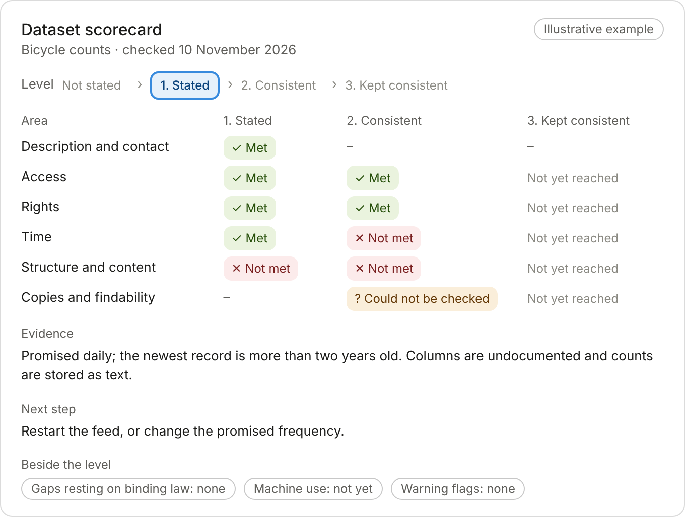
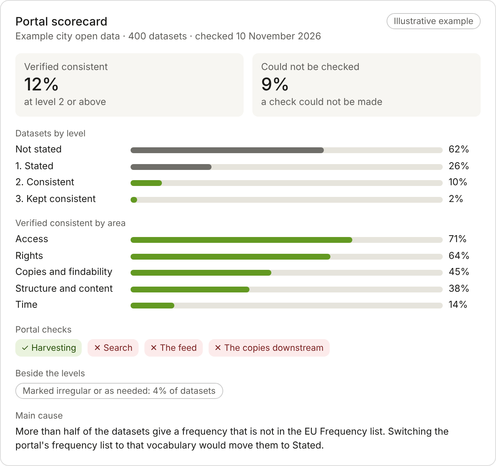

# Open data best practice rule reference for portals and AI use

Version 0.1, draft for comment · 12 November 2026 · Alex Gluhak

## About this reference

This is the companion to the [Open data best practice guidance for portals and AI use](guidance.md). The guidance explains the principles, the levels and what a good dataset entry looks like, in plain words. This reference holds the checkable form: the 40 rules with their basis in law or standards, the ten maintenance rules, the scorecards that report the results, the moment at which each rule is set or broken, and the typical failures. It is written for the people who run the checks or build them into a publishing workflow.

Like the guidance, it is best practice, not a standard or a new norm, and a table built on it is not a legal audit.

## How the rules relate to the levels

A dataset starts at "Not stated" and earns each level by evidence. Each level has a few gate rules; a dataset earns the level only when every gate was checked and passed, and each level needs the one before.

| Level | Question it answers | Gate rules |
| --- | --- | --- |
| 1. Stated | Does the entry say what can be checked? | D1, L2, T2 |
| 2. Consistent | Does the data match what the entry says today? | A1, L4, T3, T5, K2 |
| 3. Kept consistent | Has it stayed consistent? | M1, M2, M5, at every check for three months, or for three update cycles where the data changes less often |

The check period for level 3, three months or three update cycles, is a starting value. It has not yet been tested in practice and is open for discussion.

Each rule is of one of two kinds, shown in the column "Kind". An **own statement** rule holds the publisher to what the entry itself says: the check compares the entry with the data, with itself or with its copies. An **outside norm** rule compares the entry or the data with law, DCAT-AP, or what a user or an AI system needs. Kind is not the same as basis: the basis says where a rule comes from, the kind says what the check compares the entry with. Of the 40 rules, six are own statement, twenty-nine are outside norm and five have a part of each; the ten maintenance rules divide five and five. The three gates at level 1 are outside norms: they are the few statements without which nothing can be checked. The eight gates at levels 2 and 3 all hold the publisher to its own statement; for T5 that is the part of the rule that compares the stated date with the content.

All other rules are reported as gaps, area by area, and do not hold a dataset back. Some rules sit beside the levels:

- **Portal checks:** F2, F3, F4, F5 and M9, reported once for the portal.
- **Warning flag:** C1 for personal data, and L1 where a licence is stated but not open, shown whatever the level.
- **Machine-use marker:** A6, fed by S3, S4 and C6.
- **Supporting practices:** K3, M4, M8 and the response time in M7, which only the publisher can show. No level depends on them.

A check that could not be made is reported as "could not be checked": the level is not earned, and nothing is counted as a fault. The update frequency counts as stated only as a value from the controlled vocabulary that applies to the portal: for DCAT-AP the EU Frequency list, which is also the default where a jurisdiction prescribes none. A promise written only in the description, a value outside the vocabulary, and the values "unknown" and "other" count as not stated. "Irregular" and "as needed" count as stated when the entry also gives a date for the data; T3 then has nothing to test, and T5 checks the date. The items the level 1 gates need must appear both on the dataset's page and in the portal's feed, and say the same in both. A publisher can change what an entry says at any time; a promise changed to match reality is not a promise broken.

## Rules

The 40 rules below are the checkable form of the guidance. Each rule ID starts with the letter of its area in the guidance's table "What a good dataset entry looks like": D description, A access, L licence (the Rights row), T time, S structure, C content, K consistency and F findability; M marks the maintenance rules. "Level" gives the level a rule belongs to, or where it sits beside the levels: portal check, warning flag, machine-use marker or supporting practice. "Gate" marks the eight rules a dataset must meet to earn Stated or Consistent; the three gates for Kept consistent are maintenance rules M1, M2 and M5. "How we verify it" says whether a rule can be checked from what the portal publishes (checked externally), or needs evidence from the publisher, such as a written procedure, a log or a check report (publisher evidence). Where a check uses patterns or samples, a clean result means "none found", not "none present". "Kind" says what the check compares the entry with: its own statement, or an outside norm. Basis tags: *Legal*, *Legal, where possible*, *Legal if in scope*, *Legal context*, *Standard*, *Own promise*, *Usability*.

| ID | Rule | Level | Applies to | Basis | Kind | How we verify it |
| --- | --- | --- | --- | --- | --- | --- |
| D1 | Title and description present | Stated (gate) | All | Standard: DCAT-AP Mandatory | Outside norm | Checked externally |
| D2 | A point of contact for the API | Stated | High-value APIs | Legal if in scope: HVD Regulation Art. 3(4) | Outside norm | Checked externally |
| D3 | Keywords, theme and publisher given | Stated | All | Standard: DCAT-AP Recommended | Outside norm | Checked externally |
| D4 | A contact email | Stated | All | Standard: DCAT-AP Recommended | Outside norm | Checked externally |
| D5 | An English description beside the local one | Stated | All | Usability; cross-language search: Open Data Directive Art. 9(1) | Outside norm | Checked externally |
| A1 | Every access link works and returns the file or service it names, not an empty one | Consistent (gate) | All | Standard: DCAT-AP Mandatory (access URL) | Own statement | Checked externally |
| A2 | Dynamic data available through an API right after collection, or within a time frame that does not unduly impair its use | Consistent | Dynamic data | Legal: Open Data Directive Art. 5(5)–(6) | Outside norm | Checked externally |
| A3 | High-value data through APIs, and as bulk download where the Annex says | Stated | High-value | Legal if in scope: HVD Regulation Art. 3(1) | Outside norm | Checked externally |
| A4 | API terms of use, quality of service and documentation published, human- and machine-readable | Stated | High-value APIs | Legal if in scope: HVD Regulation Art. 3(2)–(3) | Outside norm | Checked externally |
| A5 | Format label from the EU File Type list, true to the file | Stated (label from the list); Consistent (label matches the file) | All files | Standard: DCAT-AP Recommended | Outside norm (label from the list); own statement (label matches the file) | Checked externally |
| A6 | A queryable API with typed fields and online documentation, plus bulk download | Machine-use marker | Tabular data | Usability; Open Data Directive recital 32 (not binding) | Outside norm | Checked externally |
| L1 | Re-use allowed for commercial and non-commercial purposes; any conditions objective, proportionate and justified | Warning flag where a licence is stated but not open | All | Legal: Open Data Directive Art. 3 and 8 | Outside norm | Checked externally |
| L2 | A licence on every distribution, given as a link to the text of the licence or sharing agreement | Stated (gate) | All | Standard: DCAT-AP Recommended | Outside norm | Checked externally |
| L3 | Licence CC0, CC BY 4.0 or an equivalent or less restrictive open licence | Stated | High-value | Legal if in scope: HVD Regulation Art. 4(3) | Outside norm | Checked externally |
| L4 | One licence, the same in the code, the title and the files | Consistent (gate) | All | Standard: DCAT-AP Recommended (licence) | Own statement | Checked externally |
| T1 | As up to date as its high-value category requires | Consistent | High-value | Legal if in scope: HVD Regulation Annex 1.2(a), 3.2(a), 4.2(a), 5.2(a), 6.2(a), 6.3(a) | Outside norm | Checked externally |
| T2 | Update frequency from the controlled vocabulary that applies (for DCAT-AP the EU Frequency list), other than "unknown" or "other"; for "irregular" or "as needed", also a date for the data | Stated (gate) | All | Standard: DCAT-AP Optional; EU Frequency list | Outside norm | Checked externally |
| T3 | Where an interval is promised, there is evidence that the data keeps to it: dates in the data, a change to the file seen from outside, or the stated data date (reported as "by stated date only"); with none of these, not met | Consistent (gate) | Datasets that promise an interval | Own promise | Own statement | Checked externally |
| T4 | Temporal coverage stated, and matching the data | Stated (coverage given); Consistent (coverage matches) | All | Standard: DCAT-AP Recommended | Outside norm (coverage given); own statement (coverage matches) | Checked externally |
| T5 | A data date separate from the catalogue edit date, and not older than the content: the content must not have changed after it; the date of publication counts where no other date is given | Stated (date given); Consistent (gate: not older than the content) | All | Standard: DCAT-AP Optional (modification date) | Outside norm (date given); own statement (not older than the content) | Checked externally |
| T6 | A status that says whether the data is still updated: ongoing, completed, deprecated or withdrawn | Stated | All | Usability; DCAT-AP 3.0.1 defines a status for the distribution only (Optional), not for the dataset | Outside norm | Checked externally |
| T7 | Gaps and changes in a series documented | Kept consistent | Series | Usability; Legal context: AI Act Art. 10(2) | Outside norm | Checked externally |
| S1 | Data structure and semantics documented online | Stated | High-value, except geospatial | Legal if in scope: HVD Regulation Annex 2.2(c), 3.2(c), 4.2(c), 5.2(b), 6.2(c) | Outside norm | Checked externally |
| S2 | One clean table per sheet, with readable headers and no print layout | Consistent | Tabular files | Legal, where possible: Open Data Directive Art. 5(1) and 2(13) | Outside norm | Checked externally |
| S3 | Every column with a description, type and unit | Stated; machine-use marker | Tabular data | Usability; Legal context: Data Act Art. 33(1)(b) | Outside norm | Checked externally |
| S4 | Code lists, vocabularies and schema linked | Stated; machine-use marker | Tabular data | Standard: DCAT-AP Optional (linked schemas) | Outside norm | Checked externally |
| C1 | Free of personal data beyond what data protection law allows | Warning flag | All | Legal context: GDPR (Open Data Directive Art. 1(4)) | Outside norm | Checked externally (patterns, samples) |
| C2 | Numbers stored as numbers, dates as dates | Consistent | Tabular data | Legal, where possible: Open Data Directive Art. 5(1) and 2(13) | Outside norm | Checked externally (samples on large portals) |
| C3 | Missing values left empty or given one documented code | Consistent | Tabular data | Legal, where possible: Open Data Directive Art. 5(1) and 2(13) | Outside norm | Checked externally (samples on large portals) |
| C4 | Rows and identifiers unique | Consistent | Tabular data | Usability | Outside norm | Checked externally |
| C5 | Locations inside the area described, in a stated coordinate system | Consistent | Data with locations | Usability | Own statement (inside the area described); outside norm (coordinate system stated) | Checked externally |
| C6 | Stable identifiers, the same columns across a series, codes that join their reference lists | Kept consistent; machine-use marker | Series and coded data | Usability | Outside norm | Checked externally |
| K1 | Copies of the same data (file, API, map layer) agree | Consistent | Data in several copies | Usability | Own statement | Checked externally |
| K2 | The entry serves the period and dataset it names | Consistent (gate) | All | Usability | Own statement | Checked externally |
| K3 | Each update checked automatically against the metadata, with the result shown | Supporting practice | All | Usability | Outside norm | Publisher evidence |
| F1 | Marked as high-value in the metadata | Stated | High-value | Legal if in scope: HVD Regulation Art. 3(5) | Outside norm | Checked externally |
| F2 | Harvested by the national catalogue and data.europa.eu | Portal check | All | Legal, where possible: Open Data Directive Art. 9(1), a Member State duty | Outside norm | Checked externally |
| F3 | Found by a plain-word API search and by an English search | Portal check | All | Usability | Outside norm | Checked externally |
| F4 | The portal's standard machine-readable feed (DCAT, or an equivalent such as data.json) carries every field the entries show, in a form the next system accepts | Portal check | All | Standard: DCAT-AP 3.0.1 | Own statement (the feed against the entry); outside norm (the form of the values) | Checked externally |
| F5 | Each hop to the national catalogue and data.europa.eu keeps the licence, frequency, contact and link to the data | Portal check | Harvested data | Standard: DCAT-AP 3.0.1; Legal, where possible: Open Data Directive Art. 9(1) | Own statement | Checked externally (one record traced per hop) |

## Maintenance rules

Ten rules keep data and metadata consistent over time; they are the same ten as in the guidance. Most of them are what level 3, Kept consistent, checks. "Checked externally" means anyone can verify the rule from what the portal publishes; "publisher evidence" means only the publisher can show it is done, for example with a written procedure, a log or a check report. "Kind" is as in the rules table.

| ID | Rule | Where it counts | Kind | How we verify it |
| --- | --- | --- | --- | --- |
| M1 | Update the data as often as the update frequency in its catalogue entry says; if that is no longer possible, change the stated frequency and say why in the description | Kept consistent (gate) | Own statement | Checked externally |
| M2 | When a series ends, change the update frequency in its catalogue entry to "never" or "not planned" and say so in the description; never let it go silent | Kept consistent (gate) | Own statement | Checked externally |
| M3 | Keep the data date in step with the content: move it when the data changes, or when a review confirms the data unchanged; keep catalogue edits on their own date | Kept consistent | Own statement | Checked externally |
| M4 | Check each new file before it is published: format, columns against the previous file, personal data | Supporting practice | Outside norm | Publisher evidence |
| M5 | Check links and services at least weekly; fix broken ones or mark them | Kept consistent (gate) | Own statement | Checked externally |
| M6 | Record breaking changes (renamed columns, new units or codes) in a change note on the entry | Kept consistent | Outside norm | Checked externally |
| M7 | Name one owner per dataset, with a team mailbox and a published response time for reported errors | Stated (the contact, D4); supporting practice (the response time) | Outside norm | Checked externally (contact); publisher evidence (response time) |
| M8 | Review each entry's metadata at least once a year and when its owner changes | Supporting practice | Outside norm | Publisher evidence |
| M9 | Keep the feed and the harvested copies in step: the portal's feed carries every field the entry shows, and the national catalogue and data.europa.eu show the same licence, dates, frequency, contact and link to the data; trace one record per chain at least once a year and after any platform change | Portal check | Own statement | Checked externally |
| M10 | For dynamic data, watch the feed and the sensors behind it, and publish outages | Kept consistent | Outside norm | Checked externally |

## Scorecards

A scorecard reports the levels for one dataset or for a whole portal. Both carry the date of the check.

### Dataset scorecard

- **Headline:** the level the dataset has earned, and the date.
- **Grid:** the six areas against the three levels. Each cell shows one of four results: met, not met, could not be checked, or not yet reached; a dash where the area has no rule at that level.
- **Evidence:** what the check found, such as the promised frequency against the newest record.
- **Next step:** the one action that would raise the level.
- **Beside the level:** the number of gaps that rest on binding law, the machine-use marker and any warning flag.

An example, for a dataset at level 1, Stated:

*Figure: dataset scorecard, an illustrative example with invented figures.*

The same grid as text:

| Area | 1. Stated | 2. Consistent | 3. Kept consistent |
| --- | --- | --- | --- |
| Description and contact (D) | Met | – | – |
| Access (A) | Met | Met | Not yet reached |
| Rights (L) | Met | Met | Not yet reached |
| Time (T) | Met | Not met | Not yet reached |
| Structure and content (S, C) | Not met | Not met | Not yet reached |
| Copies and findability (K, F) | – | Could not be checked | Not yet reached |

Evidence: promised daily, newest record more than two years old; columns undocumented and counts stored as text. The broken promise under Time is a gate, and it holds the dataset at Stated; the gaps under Structure and content are reported and do not change the level. Next step: restart the feed, or change the promised frequency.

### Portal scorecard

- **Headline number:** the share of datasets verified consistent, that is at level 2 or above. It rises only when owners state more and what they state holds; leaving fields empty cannot raise it.
- **Could not be checked:** the share of datasets where a check could not be made.
- **Datasets by level:** the shares at Not stated, Stated, Consistent and Kept consistent.
- **Verified consistent by area:** the same share for each of the five areas that have a rule at level 2, which shows where the portal is weakest. Description and contact has none.
- **Portal checks:** F2 to F5, each met or not met.
- **Main cause:** where one gap holds most datasets at Not stated, the card names it.
- **Frequency "irregular" or "as needed":** the share of datasets whose update frequency in the catalogue entry is "irregular" or "as needed", for which T3 has nothing to test. Where it is more than half, the card says so in its comments, because the headline then rests mostly on entries that promise nothing about timing.

An example:

*Figure: portal scorecard, an illustrative example with invented figures.*

## Where each rule is set or broken

A dataset passes through six moments, from setting up the portal to retiring the entry, as described in the article "Published once, promised forever". Each rule is set, or broken, at one of them, which tells a portal team who has to act and when.

| Moment | What goes wrong there | Rules | Who acts |
| --- | --- | --- | --- |
| 1. Setting up the portal | Value lists, defaults and the shape of the feed reach every entry that follows | T2, A5, A6, L2, L4, F1, F4, S4 | Portal team |
| 2. Creating the entry | Fields are filled in, but vague or wrong from the first day | D1, D2, D3, D4, D5, L1, L3, T4, T6, S1, S3, M7 | Dataset owner |
| 3. Publishing each release | Content errors arrive with the file | C1 to C6, S2, A5, M4, M6 | Dataset owner, publishing pipeline |
| 4. Keeping it true | The data drifts away from what the entry promises | A1 to A4, T1, T3, T5, K1, K2, K3, M1, M3, M5, M10 | Dataset owner, with an outside check |
| 5. Passing it on | The feed and the copies downstream lose what the portal holds | F2, F3, F4, F5, M9 | Portal team, national catalogue |
| 6. Changing or retiring it | An ended or replaced series stays marked as ongoing | T6, T7, M2, M6, M8 | Dataset owner |

## What goes wrong

Twenty-six typical failures, each a gap against one or more of the rules above, with what each can look like on a portal and the gate it fails, if any. A failure that fails no gate is still reported, and the dataset keeps its level. The last column gives the kind of rule that is broken: the publisher's own statement, or an outside norm.

| Failure | What happens | What it can look like | Rules | Gate it fails | Kind |
| --- | --- | --- | --- | --- | --- |
| Promise broken | The entry promises updates the data no longer gets | A "real-time" feed frozen for months or years; a series promised daily whose last record is years old | T3, A2, M1 | Level 2: T3 (the data keeps to the frequency) | Own statement |
| Promise undefined | The update frequency in the catalogue entry is free text, a value outside the vocabulary, or "unknown" or "other", so no one can tell whether the data is late | A frequency in free text or outside the vocabulary, such as "Frequent" or "continuing", or the value "unknown" | T2 | Level 1: T2 (update frequency) | Outside norm |
| Date over old content | The only date shown changes on catalogue edits, so old data looks new | Historical data showing a recent date because the description was edited; hundreds of entries edited on the same day in a bulk update | T5, M3 | None; reported as a gap | Own statement |
| Entry points elsewhere | The entry serves an archived source, another city or another period | Entries pointing to an outdated or missing source; a city dataset that opens a neighbouring city's figures; a quarter's contracts serving the previous quarter's files | K2 | Level 2: K2 (the entry serves what it names) | Own statement |
| Copies disagree | The same data differs between file, API and map layer | A CSV and an API that stop at a fixed row limit while the map layer holds all the data; a queryable copy that stopped years before the live map layer | K1 | None; reported as a gap | Own statement |
| Label not the file | The format label says one thing, the file is another, empty or replaced | A PDF labelled as a spreadsheet; a file labelled Excel that is a CSV, or an empty placeholder | A5 | None; reported as a gap | Own statement |
| File missing or empty | The link returns an error or nothing | A download link that returns "not found", a zero-byte file, or a file with headers only | A1, M5 | Level 2: A1 (every link returns what it names) | Own statement |
| Numbers as text | Sums, filters and sorting fail | Amounts and counts stored as text, so an API cannot sum or sort them; spreadsheets that hold whole CSV rows in a single cell | C2, S2 | None; reported as a gap | Outside norm |
| Stand-in values | "No value" is written as a value | Many spellings of "no value" in one dataset; "-", "?", "unknown" or 9999 entered as if they were values | C3 | None; reported as a gap | Outside norm |
| Columns undocumented | No one can say what a column means or in which unit | Hundreds of columns with no description, type or unit | S3, S1 | None; reported as a gap | Outside norm |
| Licence contradicts itself | Code, title and harvested copy name different licences | A dataset coded CC BY-SA 4.0 but titled CC BY 4.0; datasets without a licence on the portal that arrive at data.europa.eu with one | L4, L2, F5 | Level 2: L4 (the same licence everywhere) | Own statement |
| Defaults, not facts | A field is filled with a default rather than measured | "utf8" set on every resource, including ZIP archives | K3 | None; reported as a gap | Own statement |
| Locations wrong | Points lie far from the place they describe | A city's tourist attractions all placed in the ocean; cat colonies near latitude 0 | C5 | None; reported as a gap | Own statement |
| Silent gaps | Data stops for months inside a series, with no note | Counters that stopped for months or years inside a series, with no note | T7, M10 | None; reported as a gap | Outside norm |
| Series change shape | Columns change from one year to the next | Columns renamed, added or dropped from one year's file to the next | C6, M6 | None; reported as a gap | Outside norm |
| Personal data published | Records identify people | A population register with one row per resident and dates of birth; an old business-register copy full of phone numbers; email addresses and mobile numbers in complaint texts | C1, M4 | None; a warning flag (C1) | Outside norm |
| High-value not marked | Datasets the rules may cover carry no marker | Addresses, base maps, air quality or traffic data that the rules plausibly cover, with no high-value marker | F1 | None; reported as a gap | Outside norm |
| No contact | Errors have nowhere to go | Almost no dataset with a contact email, or one central mailbox for everything | D4, M7 | None; reported as a gap | Outside norm |
| Duplicates | Rows or identifiers repeat | One identifier on every row of a dataset; one month's minutes published twice | C4 | None; reported as a gap | Outside norm |
| Not found in English | A search in English finds nothing | An English topic word that finds nothing where the local word finds dozens; an API search that returns nothing in any language | F3, D5 | None; a portal check (F3) | Outside norm |
| Feed leaves fields out | The machine-readable feed that harvesters and agents read carries less than the portal shows | A feed with no licence, frequency or contact on any entry; a feed that lists only a fraction of the catalogue | F4, M9; L2 and T2 where the feed leaves out the licence or frequency | Level 1: L2 or T2, where the feed leaves out the licence or frequency; also a portal check (F4) | Own statement |
| Lost on the way | A national catalogue or data.europa.eu drops what the source carried | A licence written as text, blanked at the first hop; records that reach the European portal with no link to the data | F5, F2, M9 | None; a portal check (F5) | Own statement |
| No licence | No one can tell what re-use is allowed | Datasets with no licence at all; a licence named only in words, with no link to its text | L2 | Level 1: L2 (licence) | Outside norm |
| Not open in practice | The licence forbids commercial use or derivatives | Datasets under a non-commercial, no-derivatives licence on an open data portal | L1 (warning flag) | None; a warning flag (L1) | Outside norm |
| Closed series still promised | A series that ended or was replaced still promises updates | Closed financial years still marked monthly; a series "up to 2022" still marked yearly | T6, M2 | Level 3: M2 (an ended series changes its frequency) | Own statement |
| Search that misleads | The API search ignores the word, or a search by meaning shows a ranked selection as if it were every match | An API that returns the whole catalogue for any word; a search box that shows a few dozen results where over a thousand entries match | F3 | None; a portal check (F3) | Outside norm |

## References

The short forms used in this reference refer to:

- Open Data Directive: [Directive (EU) 2019/1024](https://eur-lex.europa.eu/legal-content/EN/TXT/?uri=CELEX:32019L1024) on open data and the re-use of public sector information (recast of Directive 2003/98/EC)
- HVD Regulation: [Commission Implementing Regulation (EU) 2023/138](https://eur-lex.europa.eu/eli/reg_impl/2023/138/oj) on high-value datasets
- AI Act: [Regulation (EU) 2024/1689](https://eur-lex.europa.eu/legal-content/EN/TXT/?uri=CELEX:32024R1689), Art. 10 data and data governance
- Data Act: [Regulation (EU) 2023/2854](https://eur-lex.europa.eu/legal-content/EN/TXT/?uri=CELEX:32023R2854), Art. 33 interoperability
- GDPR: [Regulation (EU) 2016/679](https://eur-lex.europa.eu/legal-content/EN/TXT/?uri=CELEX:32016R0679)
- DCAT-AP 3.0.1: [DCAT Application Profile for data portals in Europe](https://semiceu.github.io/DCAT-AP/releases/3.0.1/) (SEMIC), and DCAT-AP HVD 3.0.0
- EU Frequency list: [Frequency authority table](http://publications.europa.eu/resource/authority/frequency); EU File Type list: [File type authority table](http://publications.europa.eu/resource/authority/file-type)
